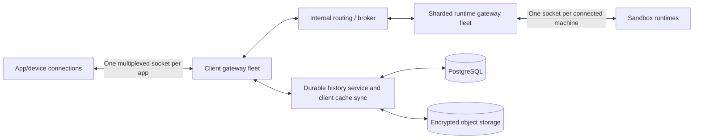

# Cloud performance and reliability

Decision date: 2026-10-29. Applies to the Rust replacement, native and browser clients.
Live provider research and reproduction: [provider measurements](cloud-provider-measurements.md).

User observation, sandbox execution tunnels and agent-loop placement are separate
decisions. The [delivery checklist](cloud-computers-delivery.md) records their current
implementation and verification. One socket carrying every operation is not a final
wire-level requirement.
Storage clarification: the target Postgres schema holds complete ordinary messages
and tool-call/result records, with bounded indexed reads for a new device. Large
outputs and attachments use object storage. Browser IndexedDB accelerates repeat
visits; the uncached first screen must work without downloading an R2 transcript.
This hot-history path is pending implementation.

## Accepted constraints

- **No warm pools, speculative machines, or keepalive traffic to extend provider fast paths.**
  This was explicitly rejected by the owner. Do not propose it again without a new
  explicit decision. Prepared images and provider-native pause/resume are allowed.
- Resume continues the existing chat, branch, files and supported process state.
  It must not fetch, rebase, rename branches or create replacement workspace data.
- New chats open immediately; independent preparation runs concurrently. Repository
  tools and the first agent turn wait for repository and credential readiness.
- New workspaces start at the resolved current remote commit. A new branch can be
  created at that commit; it does not require rebasing. Existing-workspace updates
  are separate explicit operations.
- The target is an independently deployable Rust schema and migration of **all
  retained data**, including financial identities, history, tool results, archives
  and provider-machine references. Old documents requiring perpetual `api_*`
  compatibility describe the previous migration approach, not this target.
- Capability detection applies to all sandbox providers. Boxd and Boat are live
  measurement targets because keys are available; transport/history behavior must
  not be implemented as provider-name branches.
- **Database notifications are not an accepted deployment dependency.** The owner
  raised traffic and failure-coupling concerns. The initial LISTEN/NOTIFY worker
  experiment was removed from this branch. Evaluate direct dispatch and a separate
  broker before choosing a replacement for worker polling.

## Measurement contract

Distinguish chat presentation, durable prompt admission, provider creation/wake,
command readiness, runtime enrollment, credentials, Git checkout, agent admission
and first token. Successful provider RPCs alone do not establish application readiness.

Targets, not measured application guarantees:

| Operation | Target |
| --- | --- |
| Previously cached conversation visible | p95 <100 ms on reference desktop |
| Durable prompt admission | p95 <300 ms in deployment region |
| Prepared new workspace executable | p50 <3 s; p95 <5 s |
| Memory-preserving resume executable | p50 <1 s, certified per provider/mode |
| Cached scroll/history/tool reads | No compute wake; no repeat network read for retained ranges |

Measure large repositories, first-time preparation, expired credentials, stopped
machines and archive restores separately. Report sample size and p50/p95 only when
enough controlled samples exist. Provider benchmarks currently prove neither app
startup latency nor first-agent-token latency.

## Current changes and remaining work

Implemented in this branch, with validation recorded in the implementation ledger:

- A bounded dirty-document feed coalesces changes for encrypted projection publication.
  Full checkpoints are limited to one pass per two seconds, with 100 ms burst
  coalescing; incremental event publication is still pending. Live RPC is independent.
  Only dirty conversation handles are opened in ordinary passes; no dirty
  subscription pins old documents in memory. A 30-second repair scan recovers lag
  and missed hints. Durable outbox retries remain separate from notifications.
- Gateway readers and writers run independently, with bounded control/data queues,
  proactive heartbeats and cancellation-owned writer tasks. Transient database lease
  failures preserve only the previously confirmed ownership interval; confirmed
  fencing and expiration still stop forwarding.
- Successful initial allocation no longer inserts a fixed two-second delay before
  runtime launch. Waiting for an actually unready guest retains bounded retries.
- Native saved-history reads can persist encrypted pages in SQLite. They reauthorize
  through a fresh head before reusing pages; disk contains no transcript keys, access
  tokens or plaintext. Account/origin/scope/generation/cursor boundaries isolate keys.
  Corrupt or unavailable cache entries fall back to verified network reads.

The page cache is an incremental improvement, **not** the completed local-first UI:
the current saved-history RPC still materializes all pages before returning, fresh
head/workspace reads require the API, browser IndexedDB is not implemented, and pages
are cursor-version-specific. Do not claim instant offline reopening from this work.

Remaining implementation stages:

1. Standalone normalized schema, versioned migrations and repeatable legacy importer.
   Preserve stable IDs, encryption metadata, external billing identities and immutable
   financial evidence. Rehearse on a copy; quiesce old writers before ownership handoff.
2. Durable ordered account/conversation events and stable command receipts. Persist
   events and cursor advances atomically. Use durable replay rather than raw RPC replay.
3. Cache-first conversation UI with range pagination, scroll anchors, virtualized
   rendering, native protected cache keys and browser IndexedDB. Cache published tool
   results and artifact references independently of execution transport.
4. One shared account event connection and one execution connection per attached
   workspace. Reconnect without clearing history. Sleeping reads do not acquire compute.
5. Startup readiness graph: allocate and prepare account/Git access concurrently;
   enroll before workspace-bound credential delivery; prepare checkout and harness
   concurrently where safe; admit the queued turn once after readiness barriers.
6. Provider capability interface and certified startup/resume paths, including Boat's
   recent-stop fast path versus cold restore. Persist runtime data only in provider-
   documented durable locations. Never assume a process snapshot preserves TCP sessions.
7. Broker/dispatch selection, worker scheduling, shared multi-instance gateway routing,
   deployment draining and capacity validation. Keep failed jobs durable and recoverable.

## Transport and storage rationale

### Revised scaling target: 10,000 users with 50–300 sandboxes each

The earlier one-client-execution-socket-per-attached-workspace diagram is a stepping
stone for the existing implementation, not the recommended topology at this scale.
The recommended target is a **shared account/conversation event subscription per
app/device**, carrying logical workspace/conversation channels. Interactive terminal
and bulk-data transports can be separately bounded if measurements justify it.
Each connected machine using our reverse tunnel keeps its
own runtime socket to a horizontally sharded runtime gateway fleet. The client
front door and runtime gateways scale independently.

For illustrative counts assuming one multiplexed app connection per device, one
device per user, and every sandbox runtime online (additional interactive transports
are excluded):

| Users | Sandboxes/user | Runtime sockets | App sockets | Total external sockets |
| --- | ---: | ---: | ---: | ---: |
| 10,000 | 50 | 500,000 | 10,000 | 510,000 |
| 10,000 | 300 | 3,000,000 | 10,000 | 3,010,000 |

Multiple chats on one machine add logical subscriptions rather than sockets. Multiple
app devices add app sockets. Sleeping machines have no active runtime socket. User
counts, allocated machine counts, connected runtimes and actively streaming turns
are separate capacity dimensions; all must appear in load-test reports.

This fleet design is **not implemented or capacity-certified** by the current patch.
Required changes before this target is credible:

- Multiplex account and execution channels with scoped authorization, per-channel
  flow control and fair scheduling. A busy terminal must not monopolize status or
  chat delivery; large artifacts use object transport instead of the chat socket.
- Route between independently placed app sockets and runtime owners. Broker clients
  are backend processes, not millions of directly connected app/sandbox clients.
  NATS is a candidate, not an accepted/provisioned deployment dependency. PostgreSQL
  jobs/history remain durable; transient routing does not replace command receipts.
- Replace per-workspace periodic PostgreSQL gateway-lease renewal with fenced
  gateway/shard ownership and batched control-plane updates. The present two-second
  renewal per room would imply 1.5 million renewals/second at three million rooms,
  before counting individual SQL statements. Increasing the socket limit alone
  cannot solve that bottleneck. Do not relax generation or lease-expiry fencing.
- Publish per-user aggregate status and subscribe to full output only for selected
  conversations. Persist background agent output without broadcasting every token
  to every user or unopened chat.
- Autoscale runtime gateways using socket count, RSS, queued bytes, egress and event
  lag, with placement headroom for failed nodes and jittered reconnects. A socket
  remains attached to its serving node until reconnect; scaling does not move it.
- Establish node capacity through staged 1k/10k/larger tests, then distributed tests
  of the required aggregate runtime count, realistic streaming mixes and node loss.
  No node count or throughput SLA is promised before measurements.
- Validate sandbox-provider quotas, compute capacity and database/storage throughput
  independently. Three million running sandboxes is also a compute provisioning
  requirement, not just a WebSocket requirement.

The recommendation for a single Railway service applies to initial integration.
At this target, evaluate an independently scalable container fleet (for example AWS
ECS) and its broker/database boundaries; hosting choice alone does not establish
capacity. [AWS WebSocket support](https://docs.aws.amazon.com/elasticloadbalancing/latest/application/load-balancer-listeners.html),
[NATS clustering](https://docs.nats.io/learn/clustering/),
[NATS resource controls](https://docs.nats.io/reference/config/).

The current defaults remain 256 sockets and a shared 32 MiB routing queue budget.
`ZUSE_CLOUD_GATEWAY_MAX_SOCKETS` and `ZUSE_CLOUD_GATEWAY_QUEUED_BYTES` configure the
API's limits. The latter does not bound total process memory (socket buffers, runtime
tasks and application data also consume memory). Input limits are not certified
capacity. A transport test exercises 200 concurrent machine sockets, ping/pong,
socket permit reclamation and shared queue-budget reclamation; sustained agent
streaming, reconnect storms, multi-instance routing and production capacity remain
to be measured.

The Rust implementation already uses Axum/Tokio; a replacement for Durable Objects
does not require writing a new distributed execution engine. PostgreSQL owns durable
control records; encrypted object storage owns large immutable outputs; client caches
own local presentation copies. The gateway transports live execution traffic.

Durable Object hibernation preserves accepted WebSockets; object memory is discarded
and must be reconstructed. Code deployments disconnect sockets. Cloudflare network
updates can also terminate connections. These facts do not diagnose the original
Electron incidents. [DO WebSockets](https://developers.cloudflare.com/durable-objects/best-practices/websockets/),
[Cloudflare WebSockets](https://developers.cloudflare.com/network/websockets/).

Whichever transport is chosen, slow readers, gateway restarts, device sleep and
network changes require durable cursors, idempotent command admission, bounded queues
and persistent local history. Direct client-to-machine transport cannot serve history
while the machine sleeps. A separate broker can handle fanout without becoming the
only copy of chat history. [NATS JetStream](https://docs.nats.io/learn/jetstream/).

PostgreSQL LISTEN/NOTIFY is only a wakeup mechanism. Notifications are delivered to
current listeners after commit; listen registration disappears on disconnect. A full
notification queue can cause notifying transactions to fail at commit, and listeners
remaining in transactions can prevent queue cleanup. This coupling is a reason to
evaluate a separate broker rather than silently make it a production dependency.
[LISTEN](https://www.postgresql.org/docs/current/sql-listen.html),
[NOTIFY](https://www.postgresql.org/docs/current/sql-notify.html).

## Hosting recommendation

Deploy the existing Rust API/gateway as a persistent container service. Railway is
the initial recommendation for operational simplicity unless the team already runs
AWS. Railway documents no inactivity timeout for WebSockets. AWS ECS with an
Application Load Balancer is also suitable; ALB supports persistent upgraded
connections and configurable idle timeouts. This is a recommendation, not a claim
that either deployment has been provisioned or benchmarked.
[Railway WebSockets](https://docs.railway.com/guides/socketio),
[ALB listeners](https://docs.aws.amazon.com/elasticloadbalancing/latest/application/load-balancer-listeners.html),
[ALB timeouts](https://docs.aws.amazon.com/elasticloadbalancing/latest/application/edit-load-balancer-attributes.html).

Start with one gateway instance near PostgreSQL and sandbox compute. Adding replicas
requires workspace owner routing; ordinary load-balancer affinity on each individual
socket does not colocate independently connected clients and runtimes. Deployments
must drain sockets and clients must recover by cursor without clearing history.
Disable hosting-platform service sleep for the control plane; this does not authorize
warm sandbox pools. No provider or hosting account has been changed for deployment.

## Acceptance gates

- Cache reopen uses a fresh authorization read, skips saved-page network requests,
  rejects cross-account/token/cursor reuse and repairs corrupt cached ciphertext.
- Dirty publication handles bursts, new conversations, receiver lag, network errors,
  cancellation and final shutdown publication without pinning all historical chats.
- Gateway tests distinguish transient lease failures from confirmed fencing; actual
  TCP WebSockets handle ping/pong and deliver close reasons.
- Large-history cache-first UI, offline reopening and full migration remain open
  until rendered workflows and migration rehearsals pass; compilation is insufficient.
- Full live acceptance must include actual Git, runtime, credential and provider-agent
  execution. Never substitute raw machine wake benchmarks for that gate.
