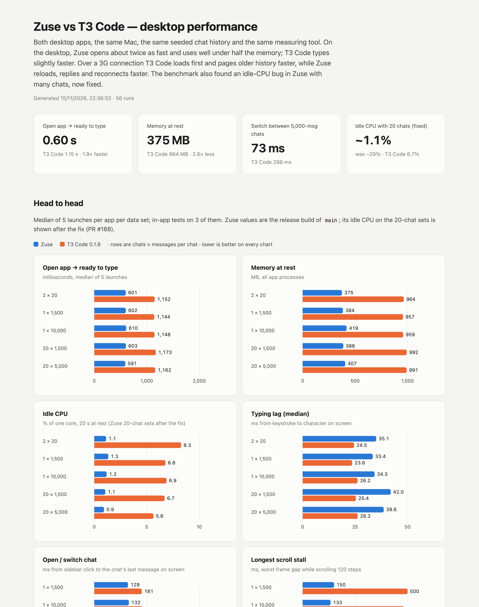
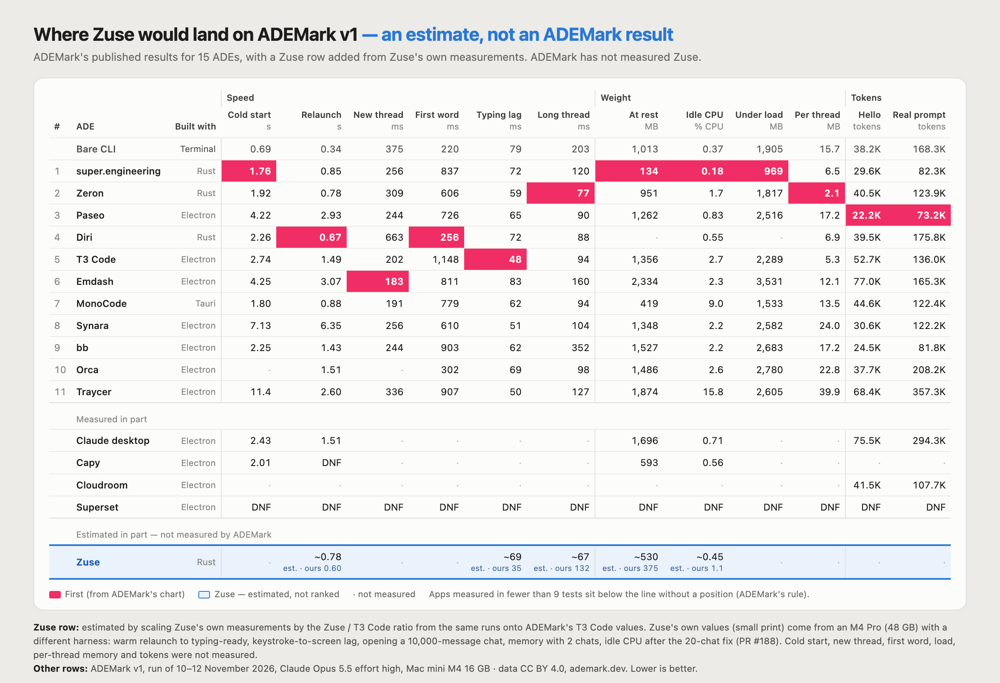

# Zuse vs T3 Code: desktop performance (November 2026)

Both desktop apps on the same Mac, with the same seeded chat history and the same measuring tool. Zuse opens about twice as fast and uses well under half the memory; T3 Code types slightly faster. The benchmark also found an idle-CPU bug in Zuse with many chats, fixed in #188.

The [interactive HTML report](benchmarks/desktop-2026-11-14/report.html) has the charts with hover values, every individual run and the earlier 3G browser comparison; download it and open it locally (GitHub shows HTML as source). Raw data: [`results.json`](benchmarks/desktop-2026-11-14/results.json).

## Head to head

Median of 5 launches per app per data set; in-app tests on 3 of them. Lower is better. Better value in bold.

| Data set | App | Open app → ready to type | Memory at rest | Idle CPU | Typing lag p50 / p95 | Open big chat | Switch chat | Longest scroll stall |
|---|---|---:|---:|---:|---:|---:|---:|---:|
| 2 chats × 20 msgs | Zuse | **0.60 s** | **375 MB** | **1.1%** | 35 / 51 ms | — | — | — |
| | T3 Code 0.1.9 | 1.15 s | 964 MB | 8.3% | **25 / 37 ms** | — | — | — |
| 1 chat × 1,500 msgs | Zuse | **0.60 s** | **384 MB** | **1.3%** | 33 / 44 ms | **129 ms** | — | **150 ms** |
| | T3 Code 0.1.9 | 1.14 s | 957 MB | 6.8% | **24 / 34 ms** | 181 ms | — | 500 ms |
| 1 chat × 10,000 msgs | Zuse | **0.61 s** | **419 MB** | **1.2%** | 34 / 41 ms | **132 ms** | — | **133 ms** |
| | T3 Code 0.1.9 | 1.15 s | 959 MB | 6.9% | **26 / 34 ms** | 184 ms | — | 483 ms |
| 20 chats × 1,500 msgs | Zuse | **0.60 s** | **388 MB** | **1.1%**\* | 42 / 79 ms | — | **69 ms** | **158 ms** |
| | T3 Code 0.1.9 | 1.17 s | 992 MB | 6.7% | **25 / 34 ms** | — | 181 ms | 500 ms |
| 20 chats × 5,000 msgs (100k) | Zuse | **0.59 s** | **407 MB** | **0.9%**\* | 39 / 62 ms | — | **73 ms** | **133 ms** |
| | T3 Code 0.1.9 | 1.16 s | 991 MB | 5.6% | **26 / 36 ms** | — | 298 ms | 487 ms |

\* After the fix in #188. Before it, Zuse idled at 29.6% and 28.9% on the 20-chat sets (see below).

Scrolling: T3 Code has fewer slow frames (about 10–11 frames over 33 ms per 120-step scroll, against 14–21 for Zuse), but its longest stall is about three times as long.

## The idle-CPU bug with 20 chats (fixed in #188)

While the window is active, the shell marks the selected chat seen during render by stamping `last_seen_at = now`. A chat counts as unseen while `last_message_at > last_seen_at`. When the last message is dated ahead of this clock (another device's clock skew, imported history), the chat stayed unseen after every mark and was re-marked on every frame: each mark notified app state, rebuilt the whole window about 64 times a second and sent `markChatSeen` to the engine. The seen stamp now never lands before `last_message_at`.

| 20 chats, idle, frontmost | Re-renders / s | App-state notifications / s | CPU |
|---|---:|---:|---:|
| Before, messages dated in the future | 62–70 | 62–70 | 28.9–29.6% |
| Before, same chats dated in the past | 2 | 0 | — |
| Before, engine alone (`zuse headless`) | — | — | 0.3% |
| **After the fix** | **~2** | **0** | **0.8–1.1%** |

## Where Zuse would land on ADEMark v1

An estimate, not an ADEMark result: ADEMark's published v1 data (CC BY 4.0, [ademark.dev](https://ademark.dev)) with a Zuse row scaled from the measurements above by the Zuse / T3 Code ratio onto ADEMark's T3 Code values. Zuse's own value is in small print under each estimate. Cold start, new thread, first word, load, per-thread memory and tokens were not measured.

## How this was measured

- **Machine.** Apple M4 Pro (14 cores, 48 GB), macOS. Other everyday apps stayed open, so treat the numbers as same-machine comparisons.
- **Builds.** Zuse release build of `main` at `9398cf44`; the fix is #188. T3 Code 0.1.9 desktop (Apple Silicon), notarized, SHA-512 verified against its update manifest.
- **Isolation.** Throwaway profiles with the home folder redirected, the same 1600×1000 window, a minimal `PATH` (no real agent CLIs), T3 Code telemetry off and a local fake Claude provider. T3 Code runs with `--use-mock-keychain` so the isolated home never shows a Keychain prompt.
- **Data.** Identical text, roles and timestamps in both apps: Zuse through its transcript importer, T3 Code through its server and database, verified by reading every message back.
- **Open app → ready to type.** Process start until a typed probe character appears in the composer, read off the screen (ScreenCaptureKit + Vision) on the uptime clock. These are warm relaunches.
- **Memory and CPU.** Physical footprint and CPU time of every app process (Zuse 1, T3 Code 6), sampled at 2 Hz for 20 s after settling.
- **Typing lag.** 40 keystrokes, each timed until it appears on screen. **Open / switch chat.** Click a sidebar row until that chat's unique last message is on screen. **Scroll.** 120 wheel steps at 60 Hz.
- **Tool.** `ademark-native`, the measuring helper from the ADEMark benchmark, built from source.

## Caveats

- History was imported, not produced by real agent turns.
- One T3 Code run (20 × 5,000, run 3) lost its window after launch and has no in-app tests; its launch counts. Its first switching run was slower (about 410–500 ms against about 185 ms later) and is in the median.
- Post-fix Zuse runs on 20 × 1,500 ran under heavy machine load; only their idle CPU is used.
- The earlier 3G comparison in the HTML report is the browser-UI benchmark from [`t3-network-benchmark.md`](t3-network-benchmark.md) (T3 Code 0.1.7, an earlier Zuse build), not rerun here.
- Not run: the ADEMark suite itself (it needs a dedicated macOS account), cold starts with cleared disk cache, battery and GPU.
